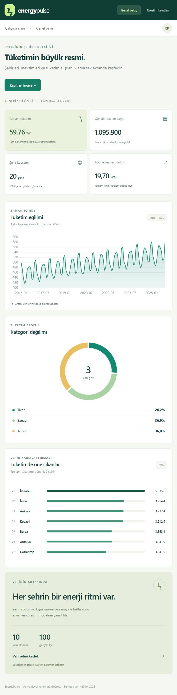
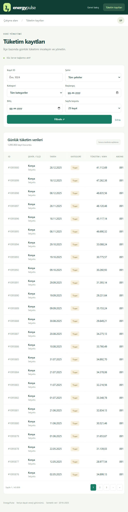
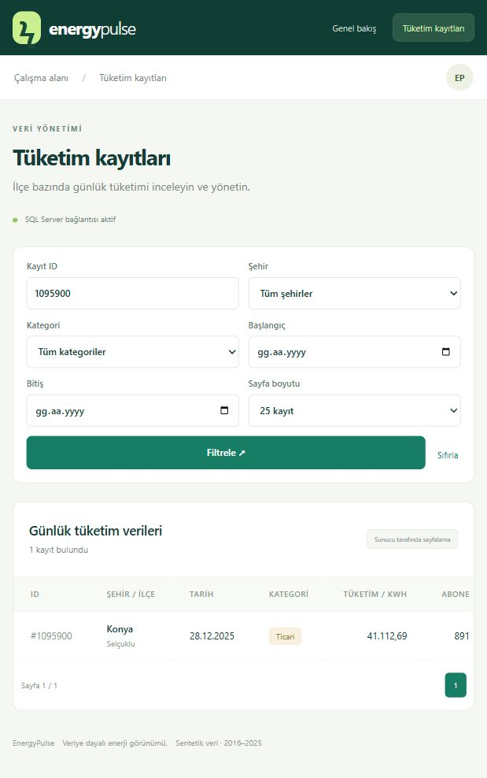
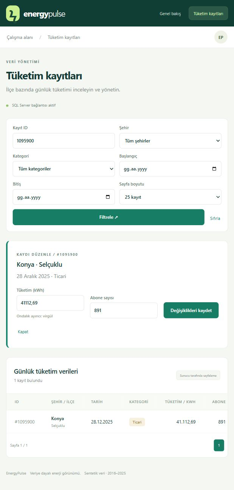

# EnergyPulse

Şehir ve ilçe bazında elektrik tüketimini analiz eden ASP.NET Core MVC uygulaması.

**1.095.900 kayıt · 20 şehir · 100 ilçe · 2016–2025**

## Özellikler

- **Dashboard:** İstatistik kartları, aylık tüketim grafiği, kategori dağılımı ve şehir sıralaması.
- **Veri tablosu:** ID, şehir, kategori ve tarih filtreleri; 25, 50 veya 100 kayıtlık sayfalama.
- **Kayıt işlemleri:** ID ile getirme, tüketim ve abone sayısını güncelleme, kayıt silme.
- **Veri seti:** Mevsim, kategori ve yıllık değişim kurallarına göre AI destekli üretilmiş sentetik veriler.

## Teknolojiler

.NET 10 · ASP.NET Core MVC · Dapper · SQL Server · Razor · Chart.js

## Proje yapısı

Uygulama tek `WebUI` projesi altında düzenlenmiştir:

```text
WebUI/
├── Controllers/
├── Views/
├── DTOs/
├── Entities/
├── Services/
├── Repositories/
├── Data/
├── Database/
└── wwwroot/
```

İstek akışı: **Controller → Service → Repository → Dapper → SQL Server**

Dapper sorguları [ConsumptionRepository.cs](WebUI/Repositories/ConsumptionRepository.cs) içinde yer alır. Veritabanı ve veri üretim işlemleri [DatabaseInitializer.cs](WebUI/Data/DatabaseInitializer.cs) üzerinden yürütülür.

## Ekran görüntüleri

### Dashboard

<details>
<summary>Görüntüle</summary>



</details>

### Veri tablosu

<details>
<summary>Görüntüle</summary>



</details>

### ID ile kayıt getirme

<details>
<summary>Görüntüle</summary>



</details>

### Kayıt düzenleme

<details>
<summary>Görüntüle</summary>



</details>
